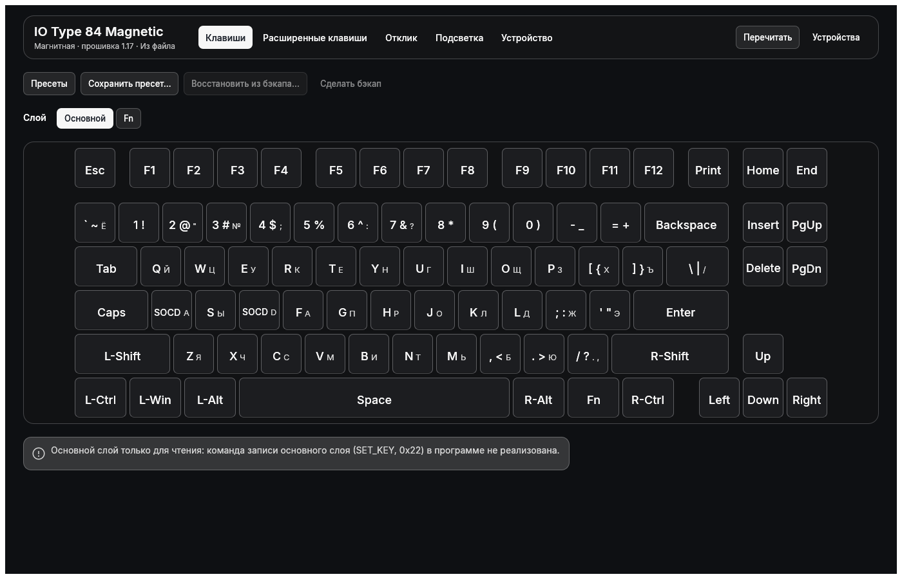
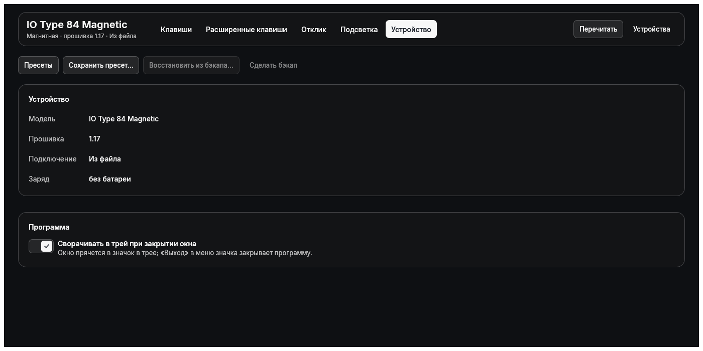
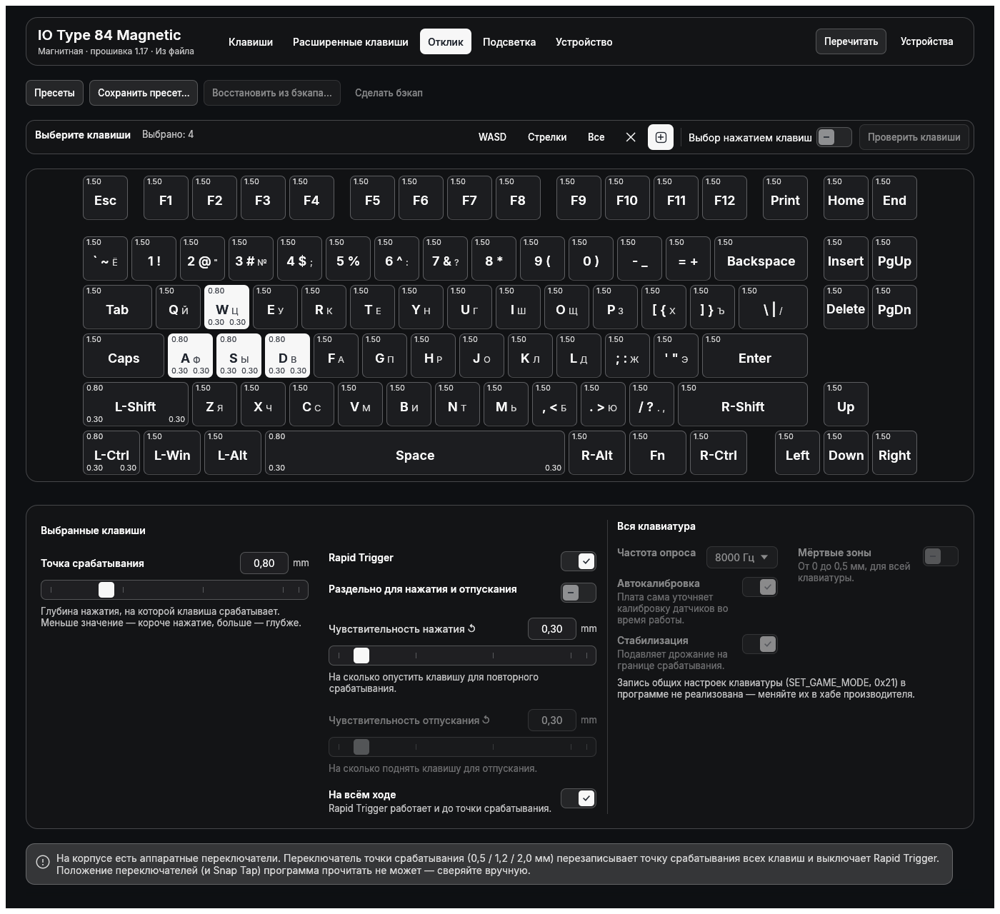
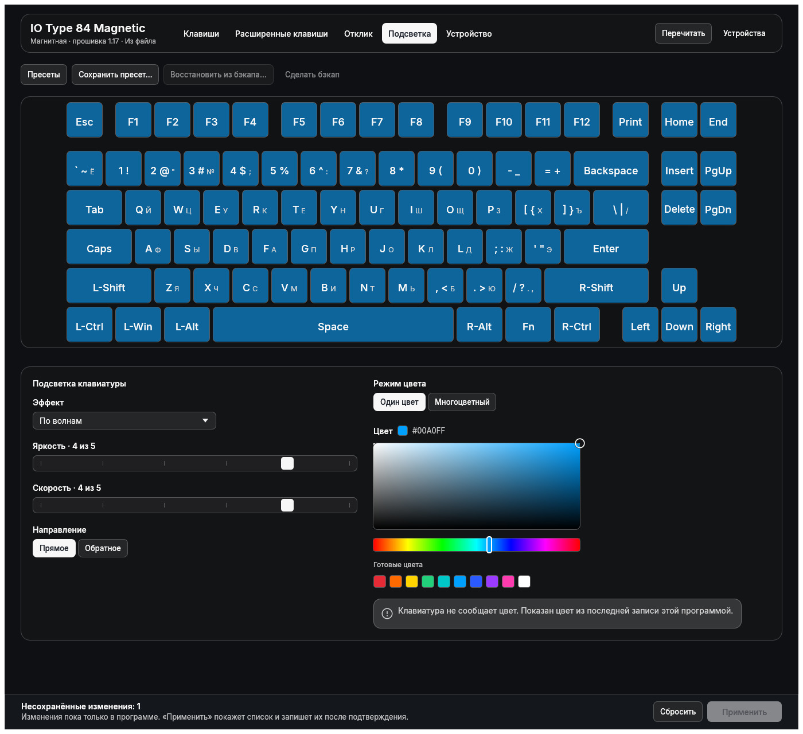
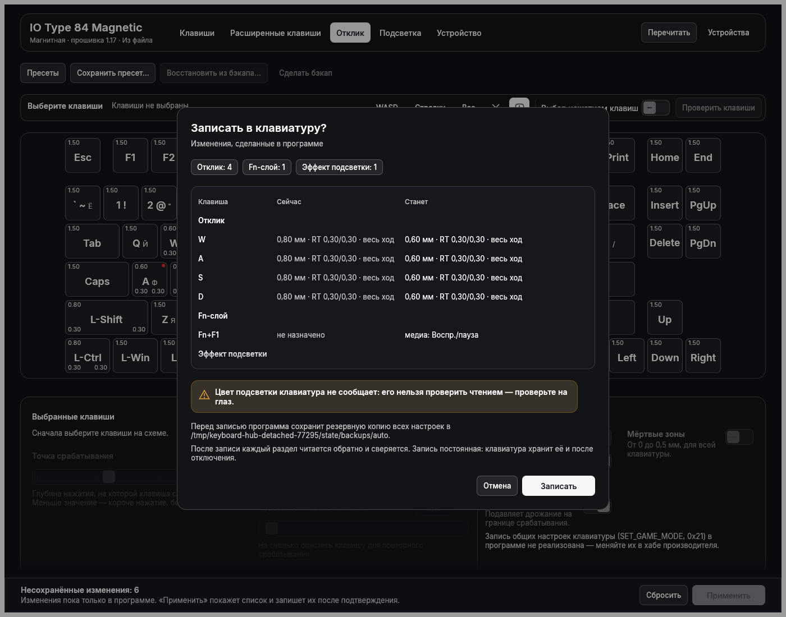

# Keyboard Hub

An **unofficial** open-source configurator for the **IO by Red Square Type 84 Magnetic** keyboard
(USB `0c45:80d6`) for Linux and Windows: a desktop app (`type84-gui`, window title "Keyboard Hub") and a
command-line tool (`type84`), built on a documented reimplementation of the keyboard's configuration
protocol.

> **Not affiliated.** This project is not affiliated with, endorsed by or sponsored by Red Square or IO.
> "Red Square", "IO" and "Type 84" are names of their respective owners and are used here only to
> describe which hardware the software works with.



| | |
|---|---|
|  |  |
|  |  |

## Features

- Read everything from the board: device info, global settings, per-key actuation and Rapid Trigger,
  base and Fn layers, lighting.
- Write per-key actuation / Rapid Trigger (Hall table), the Fn layer, the lighting effect and per-key colours.
- Full JSON backups, `verify-backup`, restore per section (`hall`, `fn-layer`, `lighting`).
- Host-side presets, combinable per section; apply them from the GUI or the CLI.
- Offline viewer for backup files (`type84-gui --from-backup FILE`).
- Tray icon, scriptable CLI (`--quiet`, `--json`, `--yes`, `--dry-run`).

Not implemented (read-only): global settings (0x21), base layer (0x22), macros and DKS.

## Safety model

The board stores every write in flash, and the protocol contains destructive commands (calibration,
factory reset, a firmware flasher), so writes are heavily guarded (details: [docs/SAFETY.md](docs/SAFETY.md)):

- **Allowlist.** Only four opcodes can ever be sent (0x27 Hall/RT, 0x26 Fn layer, 0x23 LED effect,
  0x24 per-key colours), through a separate opt-in write session. The read-only transport cannot write.
- **Dangerous opcodes are never sent** (calibration, reset, ISP/firmware flashing, ...).
- **Preview first.** Every write shows a diff (`--dry-run`, or the GUI confirm dialog).
- **Automatic backup** of every block before each write.
- **Readback.** Each written block is read back and compared; errors name the backup and the restore command.

Hardware verified on firmware 1.17: all reads, and writes of 0x27, 0x26, 0x23 (the effect colour is applied
but never reported by reads) and 0x24 (per-key colours persist across a replug).

## Hardware notes

- The **actuation switch on the case** (3 positions) makes the firmware rewrite the whole Hall table
  (actuation := preset, Rapid Trigger off). Re-apply your preset afterwards.
- The **Snap Tap switch** changes nothing that can be read from the host.
- The factory keymap has an A/D SOCD (Snap Tap) pair.
- **Fn+Delete is a factory reset** of the keyboard. Do not press it by accident.

## Install and build

Requires a recent stable Rust toolchain.

```sh
cargo build --release --workspace
# binaries: target/release/type84 and target/release/type84-gui
```

### Linux

Build dependencies (Debian/Ubuntu names): `pkg-config libudev-dev libhidapi-dev libgtk-3-dev
libxkbcommon-dev libwayland-dev libx11-dev`. At run time the app talks to the keyboard over hidraw, so
your user needs access to the device node. Create `/etc/udev/rules.d/70-keyboard-hub.rules`:

```
KERNEL=="hidraw*", SUBSYSTEM=="hidraw", ATTRS{idVendor}=="0c45", ATTRS{idProduct}=="80d6", TAG+="uaccess"
```

The number must be **below 73** so that the rule runs before `73-seat-late.rules`, which applies
`uaccess`. Then `sudo udevadm control --reload && sudo udevadm trigger` and replug the keyboard.

### Windows

Build with the MSVC toolchain (`x86_64-pc-windows-msvc`); no extra libraries are needed. Release builds
are attached to GitHub releases. Note: there is **no cross-process write lock on Windows**, so do not run
the CLI and the GUI as writers at the same time.

## CLI

```sh
type84 info                      # list interfaces, read device info
type84 dump                      # print settings, lighting and the per-key table
type84 backup                    # full JSON backup
type84 preset list
type84 preset apply light-wasd --dry-run
type84 preset apply light-wasd --yes
```

Full reference: [docs/CLI.md](docs/CLI.md). Example presets are in [presets/](presets/); the CLI reads
presets from `~/.config/type84/presets`.

### Scripting

Bind a desktop hotkey (or a game-launcher hook) to a preset:

```sh
type84 preset apply <name> --yes --quiet
```

Without a terminal on stdin, writes are refused unless `--yes` is given. Exit codes are listed in the CLI doc.

## Protocol documentation

[docs/PROTOCOL.md](docs/PROTOCOL.md) documents the protocol (framing, opcodes, block layouts, hardware
verification log); [docs/SAFETY.md](docs/SAFETY.md) documents the write guards.

## Third-party assets and credits

- **Fonts:** Inter (Copyright (c) 2016 The Inter Project Authors), SIL Open Font License 1.1, in
  `crates/type84-gui/assets/fonts/` together with [OFL.txt](crates/type84-gui/assets/fonts/OFL.txt).
- **Prior art:** [chernyhim/type84-configurator](https://github.com/chernyhim/type84-configurator), an
  independent reverse-engineering project for the same keyboard. It was used as a cross-check of the
  protocol; no code was copied from it.
- The protocol was worked out by observing the keyboard's own behaviour and the vendor's web configurator
  for interoperability. No vendor code or assets are distributed in this repository; `docs/` cites only
  short identifiers and byte offsets.
- Rust crates are used under their own licences (see `Cargo.lock`).

## Licence

[MIT](LICENSE) (c) 2026 Arteminariy.

## Disclaimer

Use at your own risk. This software writes to the keyboard's flash memory. The authors are not responsible
for bricked or misbehaving devices; keep backups and read [docs/SAFETY.md](docs/SAFETY.md) first.

## По-русски

**Keyboard Hub** - неофициальный конфигуратор клавиатуры IO by Red Square Type 84 Magnetic
(USB `0c45:80d6`) для Linux и Windows: приложение с окном (`type84-gui`) и консольная утилита (`type84`).
Проект не связан с Red Square и IO; названия используются только для описания совместимого железа.

- Чтение всего состояния, запись точек срабатывания и Rapid Trigger, слоя Fn, эффекта и цветов подсветки.
- Защита записи: белый список из четырёх опкодов, опасные команды не отправляются, превью, автобэкап
  и проверка чтением. Подробнее в [docs/SAFETY.md](docs/SAFETY.md).
- Переключатель режимов срабатывания на корпусе перезаписывает таблицу Hall; Fn+Delete - сброс до заводских.
- Linux: правило udev нужно назвать с номером меньше 73 (например `70-keyboard-hub.rules`, тег `uaccess`).
- Сборка: `cargo build --release --workspace`. Скрипты: `type84 preset apply <имя> --yes --quiet`
  можно повесить на горячую клавишу.
- Лицензия MIT. Используйте на свой риск: программа пишет во флеш клавиатуры.
